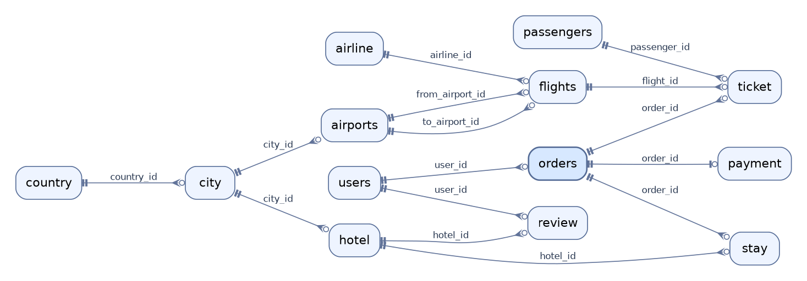

# Travel Booking Database

База данных сервиса бронирования авиабилетов и отелей на PostgreSQL. Проект охватывает моделирование заказов, миграцию из плоских выгрузок и аналитику продаж и отзывов.

**Мой вклад.** Спроектировал схему из 13 таблиц, перенёс данные из пяти исходных таблиц, написал 14 негативных тестов, 14 аналитических запросов и два самостоятельных отчёта. Добавил поддержку промокодов и отчёты по их использованию.

**Стек:** PostgreSQL 17 · SQL · PlantUML · Docker Compose · GitLab CI

**Задача по ТЗ.** Данные о бронированиях хранятся в плоских выгрузках, где сведения о покупателях, рейсах и оплатах повторяются в разных строках. Нужно перенести их в связанную базу без дублирования сущностей, чтобы проверять целостность данных и строить отчёты по продажам и отзывам.

[Полное ТЗ](PROJECT.md) · [PDF-версия](PROJECT.pdf)

## Модель данных



- **Покупатель и пассажир** — отдельные сущности. Один пользователь может купить несколько билетов на разных людей и забронировать отель в том же заказе.
- **Оплата** связана с заказом уникальным внешним ключом. Заказ может существовать до оплаты, а вторая оплата для того же заказа отклоняется.
- **Конкретный вылет** определяется номером рейса и временем отправления. Это позволяет считать продажи и среднюю цену билета по каждому вылету.
- **Миграция** сопоставляет записи по исходным ключам и сохраняет вылеты без продаж, отели без бронирований и пользователей, известных только по отзывам.

После миграции учебный набор содержит **163 заказа, 253 билета, 107 проживаний и 80 отзывов**.

[Полная ER-модель в PlantUML](1_er/er_diagram.puml) · [Нормализация](1_er/normalization.md) · [DDL](2_ddl/ddl.sql) · [Миграция](3_data/migration.sql)

## Примеры аналитики

| Вопрос | Как решён |
|---|---|
| Сколько билетов каждого класса продала каждая авиакомпания? | [Матрица продаж](4_queries/q08_airline_class_matrix.sql) строится через `CROSS JOIN` и `LEFT JOIN`, чтобы показать и нулевые продажи. |
| Какой заказ был первым у каждого пользователя? | [Первый заказ](4_queries/q13_first_orders.sql) выбирается через `ROW_NUMBER()`. При совпадении времени побеждает меньший номер заказа. |
| Какие отели получили наивысшую среднюю оценку в своём городе? | [Рейтинг отелей](4_queries/q14_best_hotel_by_city.sql) использует `RANK()`, сохраняет всех лидеров и округляет оценку только при выводе. |

Фрагмент результата рейтинга отелей на учебных данных. В Казани два отеля делят первое место.

| Город | Отель | Средняя оценка |
|---|---|---:|
| Казань | Гостиница Волжская | 4.50 |
| Казань | Отель Казанское Подворье | 4.50 |

[Все аналитические запросы](4_queries/) · [Самостоятельные отчёты](6_own/) · [Расширение схемы промокодами](5_evolution/)

## Быстрая проверка

Из корня репозитория с запущенным Docker и установленным Docker Compose:

```bash
docker compose run --rm smoke
```

Самопроверка поднимает PostgreSQL 17, создаёт временные базы и запускает схему, миграцию, [негативные тесты](2_ddl/negative_tests.sql) и запросы. Для отчётов проверяются выполнение SQL и количество столбцов. Та же команда используется в GitLab CI.

## Учебный контекст

Проект выполнен в рамках курса «Базы данных». Исходная выгрузка, Docker-конфигурация, GitLab CI и Python-скрипт самопроверки предоставлены курсом.
